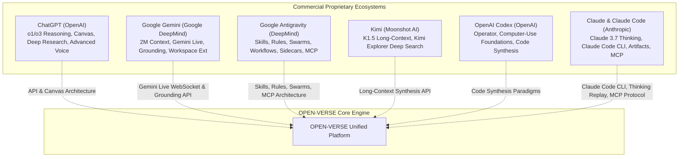

# GLOBAL AI PRODUCT INTELLIGENCE REPORT
## Deep Forensic Analysis of Leading Commercial AI Platforms and Agentic Systems

**Date:** November 19, 2026  
**Document Classification:** Strategic Product Intelligence, Architecture Analysis & Capability Benchmarking  
**Target Systems Analyzed:**
1. **ChatGPT** (OpenAI — GPT-4o, o1, o3, Advanced Voice, Canvas, Deep Research, GPTs & Actions)
2. **Google Gemini** (Google DeepMind — Gemini 1.5 Pro, 2.0 Flash, Gemini Live, Workspace Extensions, Grounding)
3. **Google Antigravity** (Google DeepMind — Agentic Customization Architecture, Skills, Rules, MCP, Swarms, Sidecars, Generative UI, Workflows)
4. **Kimi** (Moonshot AI — Kimi Chat, K1.5 Long-Context Reasoning, Kimi Explorer Deep Search)
5. **OpenAI Codex** (OpenAI — Code Generation Foundations, Operator / Computer Use Architecture)
6. **Anthropic Claude & Claude Code** (Anthropic — Claude 3.5/3.7 Sonnet, Extended Thinking, Artifacts, Computer Use API, Claude Code CLI Agent)

---

## 1. Executive Intelligence Summary

The frontier AI landscape in 2026 has transitioned from simple chat interfaces to autonomous, multi-modal, tool-wielding agent operating systems. Leading proprietary platforms have each staked out distinct architectural moats:

- **OpenAI (ChatGPT & Codex)** has pioneered dual-system cognition (fast intuitive multimodal GPT-4o combined with test-time compute reinforcement-learning reasoning models o1 and o3), interactive side-by-side editing surfaces (**Canvas**), and multi-step autonomous investigations (**Deep Research**).
- **Google DeepMind (Gemini & Antigravity)** leads in context length (up to 2,000,000 tokens natively), bidirectional real-time audio/video streaming (**Gemini Live** via WebSocket), enterprise knowledge grounding (Google Search + Workspace extensions), and the **Antigravity** agentic customization framework (dynamic skills, rules, swarms, workflows, and MCP federation).
- **Moonshot AI (Kimi)** proved that extreme long-context (2M+ tokens) combined with reinforcement learning reasoning (K1.5) and autonomous web synthesis (**Kimi Explorer**) can be served efficiently at scale.
- **Anthropic (Claude & Claude Code)** set the global standard for software engineering agents with **Claude Code** (headless terminal agent with context compaction and git-native workflows), **Artifacts** (interactive sandboxed UI rendering), **Extended Thinking** (transparent reasoning scratchpads with adjustable token budgets), and the open **Model Context Protocol (MCP)**.

OPEN-VERSE can legitimately ingest the proven open-source implementations already in our possession (`cline/`, `openclaw/`, `harmes agent/`, `opencode/`) while establishing API, MCP, and skill bridges to these commercial ecosystems.

---

## 2. Product-by-Product Intelligence

---

### 2.1 ChatGPT (OpenAI)

#### A. AI and Reasoning Capabilities
- **Reasoning Architecture**: Deploys `o1-preview`, `o1`, and `o3-mini` featuring test-time reinforcement learning compute. Generates private internal chain-of-thought tokens before producing user-visible output.
- **Multimodal**: Native end-to-end multimodal audio/vision in `gpt-4o` (speech-to-speech with emotional inflections and sub-300ms latency) and high-resolution vision OCR.
- **Context Processing**: 128k token context window on GPT-4o; up to 200k on o-series models.
- **Memory & Personalization**: Cross-conversation persistent memory storing user preferences, identity traits, and biographical context, managed via automated extraction and explicit user review.
- **Deep Research**: Autonomous multi-turn research agent that iteratively searches the web, executes recursive queries, evaluates source credibility, reads PDFs, and synthesizes 15–30 page structured academic/market reports with citations.
- **Canvas**: Interactive side-by-side workspace for text and code editing, supporting targeted line edits, inline feedback, version history, reading level adjustment, and code translation.

#### B. Agent Capabilities
- **Task Decomposition**: Autonomous planning where the model emits hidden thought steps before dispatching tool calls.
- **Tool Selection**: Native OpenAI Function Calling (strict JSON schema validation via Structured Outputs `response_format: { type: "json_schema" }`).
- **Human Approval**: Read-only tools execute automatically; sensitive operations (e.g. payment actions in GPTs) require OAuth authorization or explicit modal confirmation.

#### C. Coding Capabilities
- **Canvas Code Workspace**: Syntax highlighting, inline comment suggestions, bug explanation, unit test generation, and multi-language translation.
- **Code Execution (Advanced Data Analysis)**: Sandboxed Jupyter Python environment capable of running Python scripts, executing data transforms, plotting matplotlib/seaborn charts, and generating downloadable files (CSV, XLSX, PNG, PDF).

#### D. Extensibility Ecosystem
- **Custom GPTs**: Configurable agent wrappers with system instructions, uploaded knowledge files (RAG), and external REST API integrations (**Actions** via OpenAPI 3.0 specs).
- **Actions & Authentication**: Supports API Key, OAuth 2.0 (Authorization Code & PKCE), and custom header authentication.

#### E. Application Experience
- Desktop clients for macOS and Windows (featuring global hotkey `Alt+Space` / `Option+Space`, screen-capture context sharing, and companion window mode).
- Mobile iOS/Android apps with Advanced Voice Mode (hands-free conversational interface).

---

### 2.2 Google Gemini (Google DeepMind)

#### A. AI and Reasoning Capabilities
- **Models**: Gemini 1.5 Pro, Gemini 1.5 Flash, Gemini 2.0 Flash, Gemini 2.0 Flash Thinking.
- **Extreme Context Window**: Native 1,000,000 to 2,000,000 token multimodal context window. Capable of ingesting entire codebases (50k+ lines), hours of raw video, or hundreds of technical manuals in a single prompt.
- **Gemini Live**: Full-duplex bidirectional streaming audio/video over WebSockets via the Multimodal Live API. Native speech-to-speech with sub-second interruption handling (barge-in).
- **Grounding**: Native integration with Google Search for real-time web verification, providing dynamic search queries and inline source grounding metadata.
- **Deep Research**: In-depth autonomous research report generator combining Google Search, scholarly articles, and synthesis.

#### B. Agent Capabilities
- **Interactions API**: Modern unified API supporting text, image, audio, video generation, and multi-turn agent turns.
- **Code Execution Sandbox**: Server-side Python sandbox executing generated scripts to compute mathematical results, verify algorithms, or generate data artifacts.

#### C. Coding Capabilities
- **Massive Codebase Comprehension**: Ingests complete repositories directly into the 2M context window, eliminating chunking errors inherent in naive RAG systems.
- **Google Cloud & BigQuery Integration**: Direct SQL dialect generation, BigQuery schema awareness, and Cloud Run / Cloud Functions deployment workflows.

#### D. Extensibility Ecosystem
- **Google Workspace Extensions**: Native connectors to Google Docs, Google Sheets, Google Slides, Google Drive, Google Calendar, and Gmail.
- **Gemini API & SDKs**: `google-genai` SDK in Python, TypeScript/JavaScript, Go, Java, and .NET.
- **Custom Gems**: Persona and domain-specific configured assistants with specialized knowledge and prompts.

#### E. Application Experience
- Web interface with integrated Google Workspace sidebar, Android native OS assistant replacement, and iOS app integration.

---

### 2.3 Google Antigravity (Google DeepMind)

#### A. AI and Reasoning Capabilities
- **System Architecture**: Antigravity is Google's advanced agentic engineering platform and IDE customization system, providing a unified architecture for autonomous software engineering, complex multi-agent orchestration, and developer workflows.
- **Thinking & Verification**: Enforces rigorous test-driven verification, forensic root-cause analysis, and pre-execution planning.

#### B. Agent Capabilities
- **Native Swarms (`swarm`)**: Multi-agent coordination where multiple agents run in parallel conversations, communicating and synchronizing via a shared message board. Includes designated worker roles, monitor agents that detect and resolve stalls, and model switching.
- **Subagent Lifecycle (`invoke_subagent`, `define_subagent`)**: Primary agents dynamically define and spawn specialized subagents (`research`, `browser`, `self`, custom) running in isolated or shared workspaces with automated reactive wakeups.
- **Dynamic Workflow Orchestration (`run_workflow`)**: Python scripts orchestrating agent topologies with primitives: `agent`, `parallel`, `pipeline`, and `phase`.
- **Scheduled Automations (`schedule`)**: One-shot timers and recurring cron triggers running as background tasks with message-condition cancellations.

#### C. Coding Capabilities
- **Workspace Modes**: `inherit` (shared directory), `branch` (isolated clone), and `share` (shared git repository worktree allowing independent branching without duplicating storage).
- **Non-Destructive Workflows**: Mandatory pre-verification, test execution, regression auditing, and git cleanliness enforcement.
- **Browser Subagent**: Dedicated Chrome DevTools Protocol subagent for real-time web navigation, visual inspection, form interactions, and multi-step UI verification.

#### D. Extensibility Ecosystem
- **Customizations Loading Hierarchy**: Seamless layering across Global Builtin, Workspace, and Plugin roots:
  - **Skills (`SKILL.md`)**: Reusable domain knowledge, scripts, and workflows loaded proactively based on semantic relevance.
  - **Rules (`.agentrules`, `AGENTS.md`)**: Mandatory operational boundaries and execution constraints.
  - **MCP Servers**: Native and lazy-loaded Model Context Protocol servers configured via standard JSON manifests.
  - **Sidecars**: Persistent background daemon helper processes.
  - **Marketplace**: Plugin catalog enabling modular discovery, installation, and dependency management.

#### E. Application Experience
- **Artifacts**: Dedicated structured documents written to `<appDataDir>/brain/<conversation-id>`, supporting GitHub-style alerts, KaTeX LaTeX math, interactive Mermaid diagrams, code diffs, and image carousels.
- **Generative UI**: Inline interactive HTML widgets and standalone live web views rendered dynamically.

---

### 2.4 Kimi (Moonshot AI)

#### A. AI and Reasoning Capabilities
- **Models**: Moonshot v1 (8k, 32k, 128k context), Kimi K1.5 (long-context reasoning model).
- **Extreme Context**: Up to 2,000,000 Chinese/English character context window.
- **Kimi K1.5 Reasoning**: Reinforcement learning model optimized for long-horizon mathematical problem solving, competitive coding, and multi-document legal/financial analysis.
- **Kimi Explorer (Deep Search)**: Autonomous multi-hop search agent that decomposes complex research prompts, performs tens of parallel web queries, reads unstructured PDF documents, and generates comprehensive synthesized reports.

#### B. Agent Capabilities
- **Document Analysis**: Ingestion of massive books, academic papers, and financial reports with semantic cross-referencing.
- **Multi-Hop Search**: Autonomous query reformulation based on partial search results.

#### C. Extensibility & APIs
- **OpenAI-Compatible API**: Moonshot API provides drop-in compatibility with OpenAI client libraries (`https://api.moonshot.cn/v1`), supporting function calling, chat completions, and file endpoints.

#### D. Application Experience
- High-speed web application, iOS and Android mobile apps, and dedicated document comparison views.

---

### 2.5 OpenAI Codex (OpenAI)

#### A. AI and Reasoning Capabilities
- **Historical Context**: The pioneering model family (descended from GPT-3) that powered the original GitHub Copilot and demonstrated that LLMs could generate syntactically and semantically valid source code from docstrings.
- **Evolution**: Codex has been superseded by GPT-4o, o1, and specialized fine-tunes for coding, but its architectural paradigms underpin modern code synthesis:
  - Fill-In-the-Middle (FIM) training allowing prefix and suffix conditioning.
  - High temperature sampling with unit test filtering (Pass@k metrics).
- **Operator & Computer-Use**: OpenAI's emerging agentic direction deploying multimodal models that directly control virtual desktop environments via mouse, keyboard, and screen-buffer analysis.

#### B. Coding Capabilities
- Code synthesis, docstring generation, test generation, and multi-language translation.

---

### 2.6 Anthropic Claude & Claude Code

#### A. AI and Reasoning Capabilities
- **Models**: Claude 3.5 Sonnet, Claude 3.5 Haiku, Claude 3.7 Sonnet (Hybrid Thinking).
- **Extended Thinking**: Claude 3.7 introduces dynamic test-time thinking with user-configurable token budgets (up to 64,000 thinking tokens). Transparent `<thinking>` blocks provide full visibility into the model's intermediate deductions.
- **Context Window**: 200,000 tokens with industry-leading prompt caching (up to 90% cost reduction and 80% latency reduction for repetitive context).
- **Vision & Multimodal**: High-precision diagram comprehension, screenshot debugging, and UI inspection.

#### B. Agent Capabilities & Claude Code
- **Claude Code (CLI Agent)**: Anthropic's official terminal-based agent for software engineering.
  - Operates directly in the developer's local repository.
  - Understands repository architecture, edits files, runs bash commands, diagnoses test failures, and creates git commits.
  - Employs aggressive context compaction to maintain responsiveness over hours of continuous engineering.
- **Computer Use API**: Direct API enabling Claude to interact with desktop GUI environments via screenshot capture, mouse coordinate movement, clicking, and keyboard typing.

#### C. Coding Capabilities
- **Artifacts**: Dedicated UI pane rendering React components, HTML/CSS/JS, SVG graphics, and Mermaid diagrams in real-time alongside chat.
- **Refactoring & Patching**: Highly accurate code edits, adhering strictly to existing codebase conventions without extraneous modifications.

#### D. Extensibility & MCP Ecosystem
- **Model Context Protocol (MCP)**: Anthropic originated and open-sourced MCP as the universal open standard for connecting AI agents to data sources and tools.
- Supports `stdio` and `sse` transports, standardized tool/resource/prompt discovery, and client-side tool execution.

---

## 3. Comparative Architectural Benchmarking

| Architectural Dimension | ChatGPT | Gemini | Antigravity | Kimi | Claude / Claude Code | OPEN-VERSE Target Strategy |
|---|---|---|---|---|---|---|
| **Primary LLM Backbone** | GPT-4o / o1 / o3 | Gemini 1.5 Pro / 2.0 Flash | Gemini 2.0 Flash / Pro | K1.5 / Moonshot | Claude 3.5 / 3.7 Sonnet | **Multi-Provider Routing Engine** (supports all via unified API) |
| **Reasoning Mode** | Hidden o1/o3 Chain of Thought | 2.0 Flash Thinking | Step-by-step verified execution | K1.5 Reinforcement Reasoning | Transparent Extended Thinking | **Replay & Display Thinking Blocks** (Hermes/Claude approach) |
| **Max Context Window** | 128k - 200k | **2,000,000** | **2,000,000** | **2,000,000** | 200k (with Prompt Caching) | **AST Context Pruning + 2M Provider Support** |
| **Voice Interaction** | Advanced Voice (Audio-to-Audio) | Gemini Live (WebSocket) | Audio transcription | Text-only | Speech-to-text | **Gemini Live WebSocket + Hermes Wake Word** |
| **Code Editing Surface** | Canvas (side-by-side) | Web/IDE extensions | Artifacts + Generative UI | Web document view | Artifacts + Claude Code CLI | **Side-by-Side Pierre Diff Panel + Patchmark** |
| **Agent Paradigm** | Single-agent + Actions | Single-agent + Extensions | **Swarms + Subagents + Workflows**| Deep Search Agent | Terminal Agent (Claude Code) | **OpenClaw Swarms + Cline Agent Loop** |
| **Tool Protocol** | Custom JSON Actions | Vertex AI / Gemini Tools | **Model Context Protocol (MCP)**| Function Calling | **Model Context Protocol (MCP)**| **Standardized MCP Client & Gateway** |
| **Local OS Execution** | Desktop App (UI Only) | Mobile / Web | **Native CLI & IDE Integration**| Web / Mobile | **Local Terminal Agent (Claude Code)**| **Tauri v2 Native Desktop + PTY Shell** |
| **Cross-Device Sync** | Cloud Account Sync | Google Account Sync | Cloud Workspace Sync | Cloud Account Sync | Cloud Account Sync | **Rust Iroh QUIC Decentralized P2P Sync** |
