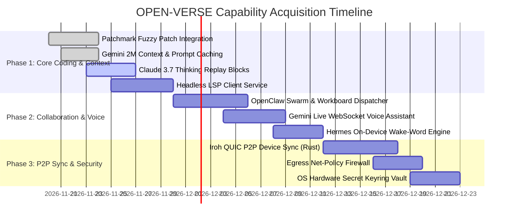

# OPEN-VERSE CAPABILITY ACQUISITION PLAN
## Concrete Engineering Strategy for Unifying Frontier Capabilities into OPEN-VERSE

**Date:** November 19, 2026  
**Document Version:** 1.0.0  
**Strategy Taxonomy:** `REUSE` | `API INTEGRATION` | `MCP INTEGRATION` | `SKILL INTEGRATION` | `PLUGIN INTEGRATION` | `ADAPTER` | `CLEAN-ROOM IMPLEMENTATION` | `UNAVAILABLE`

---

## 1. Acquisition Strategy Matrix

| # | Capability Target | Benchmarked System | Selected Acquisition Strategy | Exact Source or Implementation Mechanism | Target OPEN-VERSE Module | Priority |
|---|---|---|---|---|---|---|
| **01** | **Fuzzy Patch Application** | OpenCode | **REUSE** | Ingest `opencode/packages/patchmark` into sidecar file editor. | `@cline/shared/src/tools/apply_patch.ts` | **P0 (Immediate)** |
| **02** | **Headless LSP Code Intelligence** | Hermes Agent | **ADAPTER** | Port `harmes agent/agent/lsp` JSON-RPC client to TypeScript service. | `@cline/core/src/services/lsp/` | **P0 (Immediate)** |
| **03** | **Decentralized P2P Device Sync** | OpenClaw | **REUSE** | Link `openclaw/crates/openclaw-iroh-node` into Tauri Rust backend. | `desktop/src-tauri/src/sync/` | **P1 (Near-Term)** |
| **04** | **Multi-Agent Swarms & Workboards**| OpenClaw | **REUSE** | Adapt `openclaw/src/agents/swarm.ts` & `src/boards/workboard.ts`. | `@cline/agents/src/swarm/` | **P1 (Near-Term)** |
| **05** | **Live Voice Assistant & VAD** | Hermes / Gemini | **API INTEGRATION + REUSE** | Connect webview audio stream to Gemini Multimodal Live API via WebSocket; adapt `harmes agent/agent/voice_live.py`. | `desktop/sidecar/voice/` | **P1 (Near-Term)** |
| **06** | **On-Device Wake-Word Detection** | Hermes Agent | **REUSE** | Ingest `harmes agent/agent/wake_word.py` engine into desktop tray. | `desktop/src-tauri/src/wake_word.rs` | **P2 (Medium-Term)** |
| **07** | **Interactive Code & Text Canvas** | ChatGPT / Claude | **CLEAN-ROOM IMPLEMENTATION** | Enhance existing Next.js webview with side-by-side editing pane using `@pierre/diffs` and Monaco editor. | `desktop/webview/components/canvas/` | **P0 (Immediate)** |
| **08** | **2,000,000 Token Context Ingestion**| Gemini 1.5/2.0 | **API INTEGRATION** | Add Gemini 1.5 Pro / 2.0 Flash with prompt caching in `@cline/llms`. | `@cline/llms/src/providers/gemini.ts` | **P0 (Immediate)** |
| **09** | **Transparent Extended Thinking** | Claude 3.7 / o1 | **API INTEGRATION + ADAPTER** | Port `harmes agent/agent/anthropic_thinking_policy.py`; render collapsible `<thinking>` blocks in UI. | `@cline/llms/src/providers/anthropic.ts` | **P0 (Immediate)** |
| **10** | **Autonomous Deep Research Engine** | ChatGPT / Kimi | **SKILL INTEGRATION** | Port recursive web search and citation synthesizer into a standard OPEN-VERSE skill (`deep-research/SKILL.md`). | `skills/deep-research/` | **P1 (Near-Term)** |
| **11** | **Egress Network Policy Firewall** | OpenClaw | **REUSE** | Ingest `openclaw/packages/net-policy` to filter outbound requests. | `@cline/shared/src/security/net-policy.ts`| **P0 (Immediate)** |
| **12** | **OS Hardware Credential Vault** | Hermes Agent | **ADAPTER** | Implement native OS keyring wrappers (Windows DPAPI, macOS Keychain, Linux Secret Service). | `desktop/src-tauri/src/vault.rs` | **P1 (Near-Term)** |
| **13** | **Multi-Channel Messaging Bridge** | OpenClaw | **PLUGIN INTEGRATION** | Package `openclaw/src/channels` as an optional headless daemon plugin. | `plugins/multi-channel-gateway/` | **P2 (Medium-Term)** |
| **14** | **Interactive Mermaid Diagramming**| OpenCode | **REUSE** | Ingest `opencode/packages/merman` for zoomable, interactive diagrams. | `desktop/webview/components/merman/` | **P2 (Medium-Term)** |
| **15** | **Proprietary Weight Replication** | ChatGPT / Claude | **UNAVAILABLE** | Legitimate model weights cannot be duplicated; access strictly via authenticated upstream APIs. | N/A (Upstream API Routing) | **N/A** |

---

## 2. Ingestion Execution Plan

### Phase 1: Core Coding, Context & Reasoning (Week 1–2)
1. **Patchmark Ingestion**: Replace line-exact replacements in `@cline/shared` with `opencode/packages/patchmark`. Eliminates edit failures on drifted indentation.
2. **2M Context & Prompt Caching**: Update `@cline/llms` to configure native Gemini 1.5 Pro/2.0 Flash 2M contexts and Anthropic prompt caching headers (`cache_control: { type: "ephemeral" }`).
3. **Extended Thinking UI**: Extract `<thinking>` tags from Claude 3.7 and Gemini Flash Thinking responses and render them as real-time expandable deduction traces in the desktop webview.
4. **Headless LSP Client**: Adapt Hermes Agent's LSP client to query `typescript-language-server` and `rust-analyzer` for diagnostics before committing code changes.

### Phase 2: Collaboration, Swarms & Voice (Week 3–4)
1. **Multi-Agent Swarm Coordinator**: Ingest `openclaw/src/agents/swarm.ts`. Expose UI controls to spawn specialized subagents (Scout, Coder, Reviewer) with shared task boards.
2. **Full-Duplex Live Voice**: Add WebSocket audio streaming to the sidecar backend connecting directly to Google Gemini Multimodal Live API.
3. **Wake-Word Listener**: Compile Hermes wake-word acoustic model into the Tauri background tray.

### Phase 3: Decentralized Sync & Hardware Security (Week 5–6)
1. **Rust Iroh QUIC P2P Sync**: Compile `openclaw/crates/openclaw-iroh-node` into Tauri `src-tauri`. Enable instant QR-code pairing between developer desktop and mobile apps.
2. **Network Policy Firewall**: Ingest `openclaw/packages/net-policy` to prevent prompt-injection-driven SSRF attacks.
3. **Hardware Vault**: Move credentials from plaintext JSON files into Windows Credential Manager / macOS Keychain.
