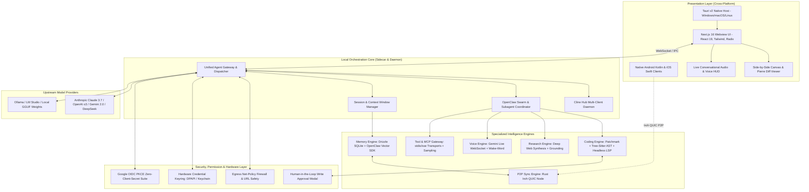

# UNIFIED OPEN-VERSE TARGET ARCHITECTURE
## Technical Architecture Specification for the All-in-One Autonomous AI Platform

**Date:** November 19, 2026  
**Document Version:** 1.0.0  
**Architectural North Star:** ONE Application, ONE Runtime, ONE Coherent Memory Model, Unified Intelligence.

---

## 1. Architectural Blueprint

OPEN-VERSE unifies frontier proprietary paradigms and battle-tested open-source engines into a modular, high-performance, single-executable desktop and mobile platform.

---

## 2. Core Subsystem Specifications

### 2.1 Multi-Provider Routing Engine
- **Primary Source**: `@cline/llms` extended with Hermes provider fallback policies.
- **Capabilities**:
  - Seamless model switching between Claude 3.7 Sonnet, OpenAI o1/o3-mini, Google Gemini 1.5/2.0, DeepSeek R1, Groq, and local Ollama instances.
  - Automatic fallback on HTTP 429 (rate limits) or 503 (outages) to designated secondary providers.
  - Transparent extraction and streaming of extended thinking tokens (`<thinking>` blocks).
  - Native prompt caching headers across Anthropic and Gemini models.

### 2.2 Unified Conversation & Canvas Interface
- **Primary Source**: [desktop/apps/examples/desktop-app/webview](file:///c:/Users/nares/Workspace/OPEN-VERSE/OPEN-VERSE/desktop/apps/examples/desktop-app/webview)
- **Capabilities**:
  - Full side-by-side editing Canvas (similar to ChatGPT Canvas and Claude Artifacts).
  - Interactive file diffing powered by `@pierre/diffs` with per-hunk rejection/acceptance.
  - Embedded pseudoterminal streaming via `@xterm/xterm` connected to Tauri PTY.
  - Rich document rendering with KaTeX LaTeX math, interactive Mermaid diagrams (`opencode/packages/merman`), and Markdown tables.

### 2.3 Software Engineering Engine
- **Primary Sources**:
  - `opencode/packages/patchmark` (Fuzzy diff application).
  - `cline/sdk/packages/core/src/services/tree-sitter` (AST symbol definitions).
  - `harmes agent/agent/lsp` (Headless Language Server Protocol).
- **Capabilities**:
  - Multi-file atomic edits with fuzzy whitespace tolerance.
  - Symbol-level codebase navigation (`find_references`, `get_type_definition`, `list_code_definition_names`).
  - Automated compile-time diagnostic verification before presenting changes to the user.
  - Checkpoint rewind and git worktree isolation.

### 2.4 Multi-Agent Swarm & Subagent Coordinator
- **Primary Source**: `openclaw/src/agents/swarm.ts` & `src/boards/workboard.ts`
- **Capabilities**:
  - Multi-agent coordination where a primary coordinator decomposes complex tasks into subtasks.
  - Asynchronous worker subagents (`Scout`, `Coder`, `Tester`, `Reviewer`) executing in parallel with scoped permissions.
  - Shared blackboard (`Workboard`) displaying real-time agent status, dependencies, and outputs.

### 2.5 Tool Execution & Model Context Protocol (MCP) Gateway
- **Primary Sources**: `@cline/shared/src/mcp.ts` & `openclaw/src/mcp/client.ts`
- **Capabilities**:
  - Full client support for external MCP servers via `stdio` and `sse` transports.
  - Bidirectional MCP sampling allowing external tools to request LLM completions from OPEN-VERSE.
  - In-tree Marketplace catalog for 1-click discovery and configuration.

### 2.6 Full-Duplex Voice & Multimodal Engine
- **Primary Sources**: `harmes agent/agent/voice_live.py`, `wake_word.py` & Gemini Multimodal Live API
- **Capabilities**:
  - On-device acoustic wake-word listener ("Hey Open-Verse") executing in the native background tray.
  - Low-latency, full-duplex WebSocket audio streaming with real-time barge-in support.
  - Multimodal image and document comprehension.

### 2.7 Decentralized Cross-Device P2P Sync
- **Primary Source**: `openclaw/crates/openclaw-iroh-node`
- **Capabilities**:
  - Zero-cloud-dependent peer-to-peer encrypted synchronization via Iroh QUIC.
  - Cryptographic QR-code / PIN pairing between desktop workstations and mobile companions.
  - Real-time replication of session histories, project settings, and active workboards.

### 2.8 Security, Egress Firewall & Hardware Vault
- **Primary Sources**:
  - `openclaw/packages/net-policy` (Egress firewall).
  - `harmes agent/agent/vault_backends` (OS hardware keyrings).
  - `OPEN-VERSE` root security suite (Google OIDC PKCE).
- **Capabilities**:
  - Defense-in-depth network sandboxing preventing SSRF and private IP exfiltration.
  - Secure credential storage in Windows DPAPI Credential Manager, macOS Keychain, and Linux Secret Service.
  - Strict human-in-the-loop approval requirements for destructive actions.
