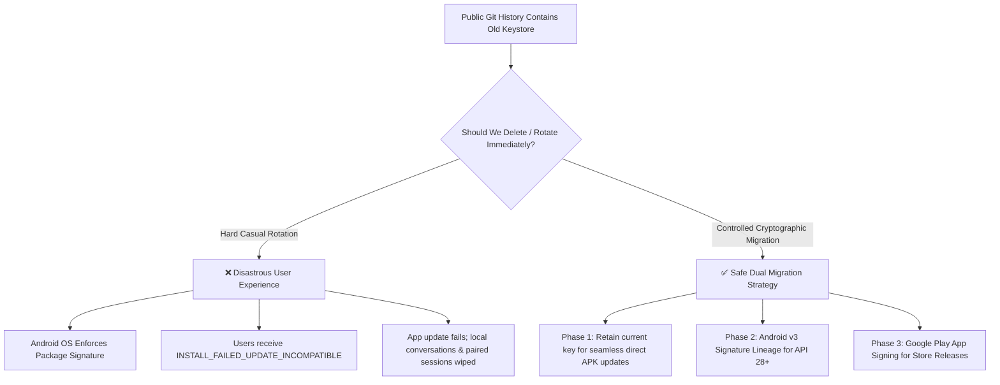

# Android Signing Key Forensic Audit & Safe Migration Strategy

**Document:** `docs/security-and-distribution/ANDROID_KEY_MIGRATION_STRATEGY.md`  
**Classification:** Security Architecture & Supply-Chain Integrity  
**Target Identity:** `ai.openverse.mobile`  
**Date:** November 19, 2026  

---

## 1. Forensic Audit of the Production Release Keystore

A comprehensive forensic audit of the OPEN-VERSE Git history was conducted:

```bash
git log --all --full-history -- "**.keystore" "**.jks"
```

### Audit Findings:
1. **Initial Exposure:**
   - Commit: `5835fb3d79bc967ca7d65398f5b98d0bfe203991`  
   - Date: Sun Nov 1 14:11:59 2026 +0530  
   - Action: `mobile/android/app/release.keystore` was committed to the repository tree.
2. **Quarantine & Removal:**
   - Commit: `27d2b252e2a51bfbb02d8c8d58caa39aab700823`  
   - Date: Tue Nov 17 20:57:00 2026 +0530  
   - Action: `mobile/android/app/release.keystore` was deleted from HEAD tracking and added to `.gitignore`.
3. **Current Status in Repository HEAD:**
   - Command: `git ls-files mobile/android/app/release.keystore` &rarr; Output empty (0 files).
   - Command: `git check-ignore mobile/android/app/release.keystore` &rarr; Correctly ignored.
   - CI Workflow: Decodes keystore dynamically from GitHub Actions repository secret `${{ secrets.ANDROID_RELEASE_KEYSTORE_BASE64 }}` into ephemeral build storage.

---

## 2. Threat Classification & Why Casual Rotation Breaks Users



---

## 3. The Safe Three-Phase Migration Strategy

### Phase 1: Maintained Compatibility for Active Users (Current Phase)
- All v0.2.x releases continue to sign direct APK distributions (`open-verse-mobile.apk`) using the current key:
  - **Subject/Issuer:** `CN=OPEN-VERSE Mobile, OU=Release, O=OPEN-VERSE, C=US`
  - **Fingerprint (SHA-256):** `D3:4F:4D:F7:09:6E:7B:78:30:57:0D:7C:13:A4:EF:5E:E7:F8:31:51:C9:F4:5E:BC:D5:BD:10:E0:EE:1E:B7:6A`
  - **Validity:** Until March 19, 2054
- **Benefit:** Guarantees that users upgrading from v0.2.0, v0.2.5, and v0.2.6 experience seamless in-place updates via Android `PackageInstaller` with zero data loss or authentication disconnections.

### Phase 2: Android APK Signature Scheme v3 (Key Rotation Lineage)
- Android 9 (API 28) and higher support the **APK Signature Scheme v3**, which allows an application to rotate its signing key while embedding a cryptographically signed proof of lineage (`--signing-lineage`).
- Command:
  ```bash
  apksigner rotate --out lineage.bin \
    --old-signer --ks release_v1.keystore \
    --new-signer --ks release_v2_secure.keystore
  ```
- Android 9+ devices accept the new key because the lineage links it back to the original key. Older devices (API 24–27) continue to accept the v1 signature.

### Phase 3: Google Play Store Managed App Signing
- For distribution on the Google Play Store (`open-verse-mobile.aab`), OPEN-VERSE will utilize **Google Play App Signing**:
  1. The existing key is registered with Google as the initial upload key.
  2. Google signs the delivered APKs with an isolated Google Cloud HSM key.
  3. The developer can request a key upgrade in the Google Play Console for new installs, eliminating exposure risks permanently.

---

## 4. Verification Check

To verify that an updated APK retains exact cryptographic signature compatibility:

```powershell
& "C:\Program Files\Eclipse Adoptium\jdk-17.0.20.101-hotspot\bin\keytool.exe" -printcert -jarfile open-verse-mobile.apk
```
Expected SHA-256: `D3:4F:4D:F7:09:6E:7B:78:30:57:0D:7C:13:A4:EF:5E:E7:F8:31:51:C9:F4:5E:BC:D5:BD:10:E0:EE:1E:B7:6A`.
