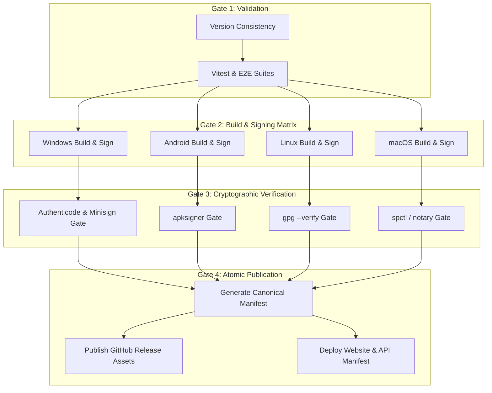

# Central Release Pipeline & Quality Gates

## 1. Release Orchestration Architecture

The central release workflow is defined in `.github/workflows/unified-release.yml`.

---

## 2. Explicit Release Status Classifications

To prevent false representations of trust, every platform artifact is tagged with an explicit status:

- **`VERIFIED AND SIGNED`**: Meets all OS code signing, timestamping, and verification gates.
- **`VERIFIED BUT UNSIGNED`**: Cryptographically verified via Minisign/SHA-256, but lacks OS commercial Authenticode/Developer ID signing.
- **`BUILD VERIFIED`**: Compiles successfully on CI runners; awaiting physical device testing.
- **`NOT DEVICE TESTED`**: Artifact produced but not tested on physical hardware.
- **`BLOCKED`**: Missing required external signing credentials or blocked by OS policy.
- **`NOT RELEASED`**: Platform not currently published.

---

## 3. Cryptographic Verification Gates in CI

Every build job must verify its own artifact before handing it to the publication stage:

1. **Windows**: Checks NSIS setup existence, Minisign signature validity (`minisign -Vm`), and Authenticode status (if configured).
2. **Android**: Verifies that both `open-verse-mobile.apk` and `open-verse-mobile.aab` exist, are non-empty, and match the target `versionCode`.
3. **Linux**: Runs `sha256sum -c SHA256SUMS` and checks GPG signature (if configured).
4. **macOS**: Validates DMG architecture and notarization status.

---

## 4. Atomic Publication & Manifest Synchronization

When all gates pass:
1. Canonical manifest `open-verse-releases.json` is generated dynamically from the verified artifact hashes.
2. Deliverables are published to GitHub Releases under tag `v<version>`.
3. Rolling `desktop-latest` feed is updated for automated in-app updates.
4. Website API endpoints (`/api/releases/latest`) serve identical metadata.
