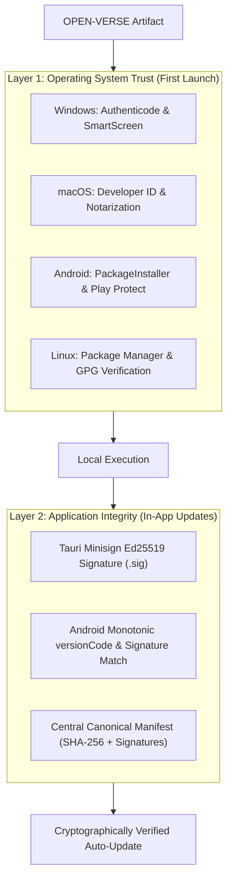

# OPEN-VERSE Security Architecture & Threat Model

## 1. Executive Security Philosophy

OPEN-VERSE is designed around a zero-trust distribution and runtime security model:
1. **Cryptographic Integrity is Mandatory**: Every distributed binary, installer, and update payload must be accompanied by verifiable cryptographic signatures (Minisign Ed25519, Android v1/v2, or GPG).
2. **Operating System Defense-in-Depth**: Application distribution must cooperate with native OS security mechanisms (Windows Defender, Smart App Control, macOS Gatekeeper, Android Package Verification) without instructing users to bypass security boundaries.
3. **Strict Credential Quarantine**: No private keys, keystores, or certificates may ever be tracked in version control. All signing material must be injected via protected CI/CD environment secrets with ephemeral lifetime.

---

## 2. Dual-Layer Trust Model

### Layer 1: Operating System Trust
- **Windows**: Microsoft Authenticode signature with SHA-256 file digest and RFC 3161 timestamping. Ensures binary integrity, displays verified publisher identity in UAC dialogs, builds SmartScreen reputation, and satisfies Windows 11 Smart App Control (SAC).
- **macOS**: Apple Developer ID Application signature, Hardened Runtime with restricted entitlements, and Apple Notary Service verification tickets stapled to disk images (`.dmg`).
- **Android**: Android APK Signature Scheme v1 (JAR signing) and v2 (whole-file hash tree) anchored by a 2048-bit RSA key.
- **Linux**: GPG detached signatures (`.asc`) and clear-signed checksum manifests (`SHA256SUMS.asc`).

### Layer 2: Application Update Integrity
- **Tauri In-App Updater**: Uses Minisign public-key cryptography (`RWTD06yEpdRbTbfZ7n8Y8U0gU5K/jCEbKWyrIyDxyWE8YLEB0j+CFLMG`). Every update archive (`.nsis.zip`) is verified before extraction. Corrupted or modified updates are immediately discarded.
- **Android Update Compatibility**: Android OS enforces that update APKs must share identical package name (`ai.openverse.mobile`) and identical certificate fingerprint (`D3:4F:4D:F7:09:6E...`). Downgrades are prevented by monotonic `versionCode` checks.

---

## 3. Secret & Credential Lifecycle

| Credential Type | Storage Mechanism | Injection Pipeline | Ephemeral Lifecycle |
| :--- | :--- | :--- | :--- |
| **Android Keystore** | GitHub Secret `ANDROID_RELEASE_KEYSTORE_BASE64` | Decoded on-the-fly in runner `/tmp` | Purged on job completion |
| **Tauri Updater Key** | GitHub Secret `TAURI_SIGNING_PRIVATE_KEY` | Environment variable in CI step | Process memory only |
| **Windows Authenticode PFX** | GitHub Secret `WINDOWS_CERTIFICATE_PFX_BASE64` | Temporary file during SignTool step | Deleted via `finally` block |
| **Linux GPG Key** | GitHub Secret `GPG_SIGNING_KEY` | Imported to runner GPG keyring | Destroyed with runner VM |

---

## 4. Web Portal & Edge Network Security

The OPEN-VERSE release distribution portal (`https://open-verse-website.vercel.app`) enforces strict HTTP security headers:

- **Content-Security-Policy (CSP)**:
  `default-src 'self' https://open-verse-website.vercel.app; script-src 'self' 'unsafe-inline' https://accounts.google.com https://apis.google.com; connect-src 'self' https://accounts.google.com https://oauth2.googleapis.com https://api.github.com https://github.com https://release-assets.githubusercontent.com; style-src 'self' 'unsafe-inline' https://fonts.googleapis.com; font-src 'self' https://fonts.gstatic.com data:; img-src 'self' data: https: blob:; frame-src 'self' https://accounts.google.com; object-src 'none'; base-uri 'self';`
- **Strict-Transport-Security (HSTS)**: `max-age=63072000; includeSubDomains; preload`
- **Permissions-Policy**: `camera=(), microphone=(), geolocation=()`
- **X-Content-Type-Options**: `nosniff`
- **X-Frame-Options**: `DENY`
- **Referrer-Policy**: `strict-origin-when-cross-origin`
