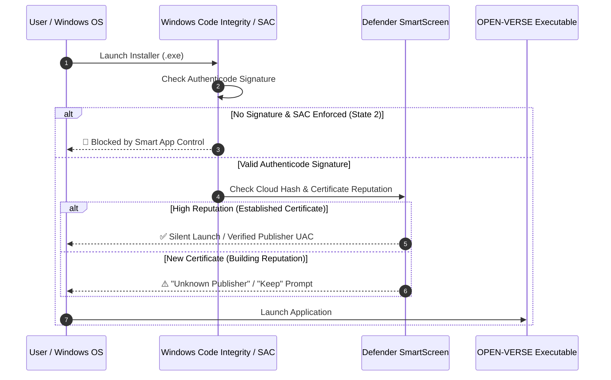

# Windows Code Signing & Authenticode Architecture

## 1. Overview & Trust Mechanics

On Windows 10 and 11, executable trust is mediated by Microsoft Authenticode, Microsoft Defender SmartScreen, and Smart App Control (SAC).



---

## 2. Component Signing Requirements

To satisfy Windows Code Integrity and prevent runtime integrity violations, signing must cover every executable component in the application distribution tree:

1. **Main Tauri Executable**: `OPEN-VERSE.exe`
2. **Bundled Sidecars**: `bin/cline-cli.exe`
3. **NSIS Generated Uninstaller**: `Uninstall.exe` (generated at build/install time by NSIS)
4. **Outer Setup Installer**: `OPEN-VERSE_<version>_x64-setup.exe`

---

## 3. Implementation: `sign-windows-authenticode.ps1`

The automated signing script is located at `desktop/apps/examples/desktop-app/scripts/sign-windows-authenticode.ps1`.

### Key Capabilities:
- **SignTool Discovery**: Auto-detects `signtool.exe` from Windows 10/11 SDK installations or falls back to PowerShell `Set-AuthenticodeSignature`.
- **SHA-256 Digest**: Signs using modern SHA-256 digest (`/fd SHA256`).
- **RFC 3161 Timestamping**: Appends trusted timestamp from DigiCert (`/tr http://timestamp.digicert.com /td SHA256`) so signatures remain valid after certificate expiry.
- **Immediate Verification**: Validates the signature with `Get-AuthenticodeSignature` immediately after signing and enforces exit code 1 if status is not `Valid`.
- **Graceful Unsigned Fallback**: If `WINDOWS_CERTIFICATE_PFX_BASE64` secret is omitted in CI, clearly logs that Authenticode credentials are not configured and avoids breaking uncredentialed community builds.

---

## 4. Verification Commands

To verify the Authenticode signature of an installer locally:

```powershell
# Check Authenticode signature status in PowerShell
Get-AuthenticodeSignature -FilePath "OPEN-VERSE_0.2.6_x64-setup.exe" | Format-List

# Verify using official Windows SDK SignTool
signtool.exe verify /pa /v "OPEN-VERSE_0.2.6_x64-setup.exe"
```

### Tauri Minisign Updater Verification:
Alongside Authenticode, the Tauri updater payload is verified using the Minisign Ed25519 public key:

```powershell
# Decode public key and signature
minisign -Vm "OPEN-VERSE_0.2.6_x64-setup.exe" -p "openverse-updater.pub" -x "OPEN-VERSE_0.2.6_x64-setup.exe.sig"
```

---

## 5. Provider Options & India Eligibility

| Provider | Mechanism | Annual Cost | SmartScreen Reputation | SAC Compatibility |
| :--- | :--- | :--- | :--- | :--- |
| **Certum Open Source Code Signing** | SimplySign Cloud HSM / PFX | €28 - €70 / yr | Rapid accumulation | 100% compliant |
| **Microsoft Store Ingestion (MSIX)** | Microsoft Store CA | $19 one-time | **Instant (Zero warning)** | **Instant 100%** |
| **Microsoft Trusted Signing** | Azure Code Signing | $9.99 / mo + Azure fees | Instant | Instant 100% |
